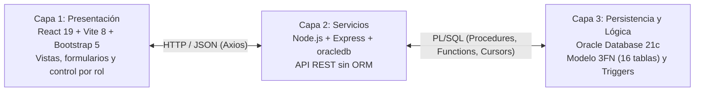

# Sistema de Gestión Integral para Clínica Veterinaria

Aplicación web Full-Stack desarrollada para centralizar y automatizar la operación clínica y comercial de una clínica veterinaria, reemplazando los registros manuales en papel. Integra gestión de pacientes, agenda médica, fichas clínicas, recetas, control y recordatorios de vacunación, inventario comercial, punto de venta (POS) y reportes gerenciales.

> Proyecto Final de **ECI224 – Base de Datos** — Universidad Católica del Maule (UCM).  
> **Docente:** Carlos Andrés Castro Bustamante.

## Tabla de Contenidos

1. [Arquitectura del Sistema](#arquitectura-del-sistema)
2. [Alcance Funcional](#alcance-funcional)
3. [Stack Tecnológico](#stack-tecnológico)
4. [Estructura del Repositorio](#estructura-del-repositorio)
5. [Instalación y Ejecución Local](#instalación-y-ejecución-local)
6. [Migración de Esquemas Existentes](#migración-de-esquemas-existentes)
7. [Equipo de Desarrollo](#equipo-de-desarrollo)
8. [Contacto](#contacto)

## Arquitectura del Sistema

El sistema implementa una **arquitectura Cliente-Servidor en 3 capas** centrada en la base de datos (*Database-Centric*). La integridad referencial, validaciones de negocio, control de concurrencia y triggers residen en **Oracle Database 21c (PL/SQL)**, mientras que **Node.js + Express** actúa como pasarela REST sin ORM devolviendo respuestas JSON estandarizadas (`{ success, data, message }`).



## Alcance Funcional

### Control de Acceso y Usuarios

* Inicio de sesión con roles diferenciados (**Administrador**, **Veterinario** y **Recepcionista**) y navegación restringida según perfil.
* Solicitud de creación de cuenta desde el login (`POST /api/auth/registro` + `PROC_SOLICITAR_USUARIO`): registra cuentas nuevas en estado inactivo con rol **Recepcionista** y cifrado `scrypt`, requiriendo activación previa por un administrador.

### 10 Mantenedores (CRUD)

Implementados mediante procedimientos almacenados, funciones con `SYS_REFCURSOR` y secuencias:

* Roles, Usuarios, Clientes, Especies, Pacientes, Proveedores, Productos comerciales, Servicios, Fichas Clínicas y Recetas Médicas.
* Catálogo de **Vacunas** separado en tabla propia (`VACUNAS`) e independiente del inventario comercial (`PRODUCTOS`).

### 5 Gestores Transaccionales

1. **Punto de Venta (POS):** Registro de ventas, detalle de ítems, anulación y descuento/restauración automática de stock mediante triggers.
2. **Agenda y Citas Médicas:** Configuración de bloques futuros por veterinario (`:00` o `:30`), reserva con control de concurrencia y liberación automática al cancelar.
3. **Inventario:** Ingreso y ajuste de stock para productos comerciales (`ES_VACUNA = 0`).
4. **Gestión Clínica:** Creación de fichas clínicas vinculadas a citas vigentes (marcando la cita como `ATENDIDA`), emisión de recetas e historial clínico por paciente.
5. **Vacunaciones y Refuerzos:** Registro de dosis por veterinarios activos (`VACUNACIONES` referenciando a `VACUNAS`) y aplicación transaccional de refuerzos.

### Reportes y Dashboards

* Resumen KPI en Panel Principal (`FUNC_REPORTE_RESUMEN_DASHBOARD`).
* Auditoría financiera de ventas por mes y año (`FUNC_REPORTE_VENTAS_MES`).
* Alertas de stock crítico de productos (`FUNC_REPORTE_STOCK_CRITICO`).
* Recordatorios de vacunas próximas o vencidas (`FUNC_REPORTE_VACUNAS_PENDIENTES`).
* Rendimiento del staff (`FUNC_REPORTE_RENDIMIENTO_STAFF`).

## Stack Tecnológico

| Capa | Tecnologías |
| --- | --- |
| **Frontend** | React 19, Vite 8, React Router, Axios, Bootstrap 5 |
| **Backend** | Node.js, Express, `oracledb`, `cors`, `dotenv`, `crypto` (`scrypt`) |
| **Base de Datos** | Oracle Database 21c (Modelo en 3FN, 16 tablas, 15 secuencias, procedimientos, funciones `SYS_REFCURSOR` y triggers) |
| **Control de Versiones** | Git y GitHub |

## Estructura del Repositorio

```text
veterinaria_ucm/
├── oracle_db/
│   ├── 01_esquema_base_es3.sql            # 5 tablas y 5 secuencias base
│   ├── 02_esquema_operativo_es3.sql       # 11 tablas y 10 secuencias operativas (incluye VACUNAS)
│   ├── 03_mantenedores_base_plsql.sql     # Auth, solicitud de cuentas y CRUD de mantenedores
│   ├── 04_gestores_y_triggers_plsql.sql   # Gestores de POS y Agenda/Citas
│   ├── 05_productos_y_clinico_plsql.sql   # Gestores de Inventario, Clínico y Vacunaciones
│   ├── 06_reportes_y_triggers_plsql.sql   # Reportes gerenciales y 5 triggers de negocio
│   ├── 07_migrar_catalogo_vacunas.sql     # Solo para migrar esquemas previos
│   ├── 08_separar_catalogo_vacunas.sql    # Solo para migrar esquemas previos
│   └── CONTRATOS_PLSQL.md                 # Contratos y firmas de integración PL/SQL
├── backend/                               # API REST en Express y conexión oracledb
├── frontend/                              # SPA en React + Vite (pages, components, services, routes, context)
├── .gitignore
└── README.md

```

## Instalación y Ejecución Local

### Prerrequisitos

* **Node.js** (v18 o superior)
* **Oracle Database 21c** (Express Edition XE local o contenedor Docker)
* **Git**

### 1. Clonar el repositorio

```bash
git clone [https://github.com/DiegoAbdiasSaldanaFuentes/veterinaria_ucm.git](https://github.com/DiegoAbdiasSaldanaFuentes/veterinaria_ucm.git)
cd veterinaria_ucm

```

### 2. Configurar la Base de Datos (Instalación limpia)

1. Verifica que los servicios de Oracle (`OracleServiceXE` y `OracleOraDB21Home1TNSListener`) estén activos y obtén el `HOST` y `PUERTO` (ej. `localhost:1521`) ejecutando:
```bash
lsnrctl status

```


2. Conéctate a la PDB (`xepdb1` en XE u `orclpdb` en Enterprise) como `sysdba` y crea el esquema del proyecto:
```bash
sqlplus sys/TU_CLAVE_SYS@HOST:PUERTO/xepdb1 as sysdba

```


```sql
CREATE USER vet_ucm IDENTIFIED BY "ClaveSegura123"
  DEFAULT TABLESPACE USERS
  TEMPORARY TABLESPACE TEMP
  QUOTA UNLIMITED ON USERS;

GRANT CONNECT, RESOURCE, CREATE SESSION, CREATE VIEW, CREATE PROCEDURE, CREATE SEQUENCE, CREATE TRIGGER TO vet_ucm;
EXIT;

```


3. Desde la **raíz del proyecto**, conéctate como `vet_ucm` y ejecuta en orden los scripts **`01` al `06**` (no ejecutes `07` ni `08` en instalaciones limpias):
```bash
sqlplus vet_ucm/ClaveSegura123@HOST:PUERTO/xepdb1

```


```sql
@oracle_db/01_esquema_base_es3.sql
@oracle_db/02_esquema_operativo_es3.sql
@oracle_db/03_mantenedores_base_plsql.sql
@oracle_db/04_gestores_y_triggers_plsql.sql
@oracle_db/05_productos_y_clinico_plsql.sql
@oracle_db/06_reportes_y_triggers_plsql.sql

```


4. Verifica que existan las 16 tablas y que todos los objetos PL/SQL hayan compilado sin errores:
```sql
SELECT COUNT(*) AS TOTAL_TABLAS FROM user_tables;
SELECT object_name, object_type, status FROM user_objects WHERE status != 'VALID';

```


5. Inserta los **3 roles base** y un usuario administrador inicial (el `COMMIT;` es obligatorio para que Node.js vea los registros):
```sql
INSERT INTO roles (nombre_rol) VALUES ('Administrador');
INSERT INTO roles (nombre_rol) VALUES ('Veterinario');
INSERT INTO roles (nombre_rol) VALUES ('Recepcionista');

INSERT INTO usuarios (id_rol, nombre_usuario, clave_hash, nombres, apellidos, activo)
VALUES (1, 'admin', '1234', 'Admin', 'Sistema', 1);

COMMIT;
EXIT;

```


### 3. Configurar y levantar el Backend

1. Crea el archivo `backend/.env` con tus datos de conexión:
```env
PORT=3000
DB_USER=vet_ucm
DB_PASSWORD=ClaveSegura123
DB_CONNECT_STRING=localhost:1521/xepdb1

```


2. Instala dependencias y levanta el servidor:
```bash
cd backend
npm install
node index.js

```


3. Verifica la conexión accediendo a `http://localhost:3000/health`.

### 4. Configurar y levantar el Frontend

1. En una segunda terminal, crea el archivo `frontend/.env`:
```env
VITE_API_URL=http://localhost:3000/api
VITE_USE_MOCKS=false

```


2. Instala dependencias y ejecuta Vite:
```bash
cd frontend
npm install
npm run dev

```


3. Abre `http://localhost:5173` e inicia sesión con `admin` / `1234`.

## Migración de Esquemas Existentes

Solo si ya tienes una base de datos creada con una versión anterior del esquema (donde las vacunas convivían dentro de `PRODUCTOS`), detén el backend y ejecuta desde la raíz del repositorio:

```sql
@oracle_db/07_migrar_catalogo_vacunas.sql

```

Este script agrega `ES_VACUNA`, invoca automáticamente `08_separar_catalogo_vacunas.sql` para migrar los registros hacia `VACUNAS`, actualiza las llaves foráneas y recompila los scripts `03` al `06`.

## Equipo de Desarrollo

| Integrante | Rol en el Proyecto | Área Principal |
| --- | --- | --- |
| **Diego Abdias Saldaña Fuentes** | Líder de Proyecto y Frontend Developer | React + Vite, arquitectura del repositorio e integración final |
| **Benjamín Ignacio Vásquez Cerda** y **Diego Abdias Saldaña Fuentes** | Backend Developer | API REST en Node.js / Express y conexión con `oracledb` |
| **Juan Ignacio Sánchez Valdez** | Especialista PL/SQL | Procedimientos almacenados, funciones, cursores y triggers |
| **Gabriel Fernando Riveros Barria** | Arquitecto de Datos | Modelo Entidad-Relación (3FN), scripts DDL y migraciones Oracle |

## Contacto

* **Diego Abdias Saldaña Fuentes** — [saldanafuentesabdiasdiego@gmail.com](mailto:saldanafuentesabdiasdiego@gmail.com)

