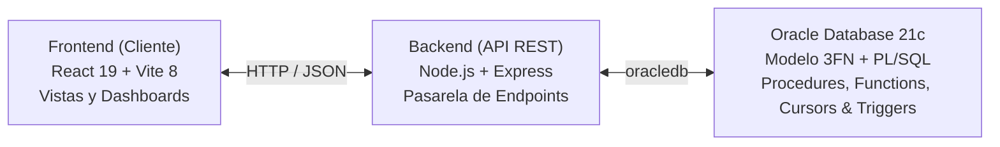

# Sistema de Gestión Integral para Clínicas Veterinarias

Aplicación web Full-Stack desarrollada para digitalizar y optimizar la operación diaria de una clínica veterinaria, reemplazando los registros manuales en papel por una plataforma centralizada. El sistema integra gestión clínica, control y recordatorios automáticos de vacunación, punto de venta (POS), control de inventario y reportes gerenciales en tiempo real.

> Proyecto desarrollado en el marco de la asignatura de **Base de Datos** — Universidad Católica del Maule (UCM).

## Tabla de Contenidos

1. [Arquitectura del Sistema](#arquitectura-del-sistema)
2. [Características Principales](#características-principales)
3. [Stack Tecnológico](#stack-tecnológico)
4. [Estructura del Repositorio](#estructura-del-repositorio)
5. [Instalación y Ejecución Local](#instalación-y-ejecución-local)
6. [Flujo de Trabajo con Git](#flujo-de-trabajo-con-git)
7. [Equipo de Desarrollo](#equipo-de-desarrollo)
8. [Contacto](#contacto)

## Arquitectura del Sistema

El proyecto implementa una **arquitectura Cliente-Servidor en 3 capas** centrada en la base de datos (*Database-Centric Architecture*). Toda la lógica de negocio crítica, la integridad referencial y las transacciones complejas residen directamente en **Oracle Database (PL/SQL)**, manteniendo el servidor Node.js como una pasarela REST ligera y desacoplada.



## Características Principales

### Gestión Clínica y Control de Vacunación

- **Historial de Pacientes:** Registro estructurado de dueños (`CLIENTES`), mascotas (`PACIENTES`), especies, fichas clínicas y recetas médicas.
- **Registro de Vacunaciones:** Control detallado de dosis aplicadas vinculadas directamente al inventario de medicamentos (`PRODUCTOS`) y al veterinario tratante (`USUARIOS`).
- **Alertas y Recordatorios de Próximas Dosis:** Consultas automatizadas mediante cursores en Oracle (`SYS_REFCURSOR`) que identifican mascotas con vacunas próximas a vencer o vencidas, facilitando el contacto oportuno con sus dueños.

### Punto de Venta (POS) e Inventario

- **Gestión Comercial:** Registro transaccional de ventas de productos y servicios veterinarios.
- **Control Automático de Stock:** Descuento de unidades y validaciones de disponibilidad ejecutadas a nivel de base de datos mediante Procedimientos Almacenados y Triggers, previniendo inconsistencias de inventario.

### Control de Acceso y Mantenedores (CRUD)

- **10 Mantenedores completos** para entidades maestras: Roles, Usuarios, Clientes, Pacientes, Especies, Proveedores, Productos, Servicios, Fichas Clínicas y Recetas.
- **Navegación segmentada por roles** (Administrador, Veterinario, Recepción/Ventas) para restringir vistas y operaciones según el perfil del usuario.

### Reportes y Dashboards

Visualización gráfica interactiva orientada a la toma de decisiones:

- Auditoría mensual de ingresos (tienda vs. servicios clínicos).
- Monitor de alertas de stock crítico.
- Panel de seguimiento de vacunaciones y actividad clínica.

## Stack Tecnológico

| Capa | Tecnologías y Herramientas |
| :--- | :--- |
| **Frontend** | React `v19.3.1`, Vite `v8.3.8`, React Router, Axios, Bootstrap 5, Chart.js / Recharts |
| **Backend** | Node.js `v26.12.1`, Express, `oracledb`, `cors`, `dotenv` |
| **Base de Datos** | Oracle Database `21c` (Modelo en 3FN, Secuencias, Procedimientos Almacenados, Funciones, Cursores y Triggers) |
| **Control de Versiones** | Git, GitHub y GitHub Desktop |

## Estructura del Repositorio

```text
veterinaria_ucm/
├── database/          # Scripts DDL (tablas, constraints, secuencias) y lógica PL/SQL
├── backend/           # Servidor Express, conexión a Oracle (oracledb) y rutas API REST
├── frontend/          # Aplicación SPA desarrollada con Vite y React
├── docs/              # Modelo Entidad-Relación (MER), documentación y presentación
├── CONTRATOS.md       # Contratos de integración (firmas PL/SQL y esquemas JSON)
├── .gitignore         # Exclusión de dependencias locales y variables sensibles
└── README.md          # Documentación principal del proyecto
```

## Instalación y Ejecución Local

### Prerrequisitos

- [Node.js v26.12.1](https://nodejs.org/)
- [Oracle Database 21c](https://www.oracle.com/database/technologies/oracle21c-windows-downloads.html) (local o vía contenedor Docker)
- Git

### 1. Clonar el repositorio

```bash
git clone https://github.com/DiegoAbdiasSaldanaFuentes/veterinaria_ucm.git
cd veterinaria_ucm
```

### 2. Configurar la Base de Datos (Oracle 21c)

1. Conectarse a la instancia de Oracle (vía SQL Developer o VS Code).
2. Ejecutar los scripts ubicados en la carpeta `/database` en orden:
   - Primero el script DDL (tablas, restricciones y secuencias).
   - Luego los scripts de lógica PL/SQL (procedimientos, funciones, cursores y triggers).

### 3. Configurar y levantar el Backend (Node.js)

```bash
cd backend
npm install
```

Crear un archivo `.env` dentro de `/backend` con las credenciales locales de Oracle:

```env
PORT=3000
DB_USER=tu_usuario_oracle
DB_PASSWORD=tu_password_oracle
DB_CONNECT_STRING=localhost:1521/XE
```

Iniciar el servidor:

```bash
npm start
```

### 4. Configurar y levantar el Frontend (Vite + React)

En una nueva terminal desde la raíz del proyecto:

```bash
cd frontend
npm install
npm run dev
```

La aplicación quedará disponible en `http://localhost:5173`.

## Flujo de Trabajo con Git

El desarrollo colaborativo se organiza mediante ramas dedicadas por capa funcional, integrando los avances a través de `develop` antes de pasar a `main`:

| Rama | Responsabilidad |
| :--- | :--- |
| `main` | Versión estable y lista para entrega |
| `develop` | Rama de integración continua del equipo |
| `feature/db-schema` | Diseño MER (3FN), tablas, constraints y secuencias en Oracle |
| `feature/plsql-logica` | Procedimientos almacenados, funciones, cursores y triggers |
| `feature/node-api` | Servidor Express, pool de conexiones `oracledb` y rutas REST |
| `feature/react-frontend` | Vistas, formularios, dashboards y consumo de API en React |

## Equipo de Desarrollo

| Integrante | Rol en el Proyecto | Área Principal |
| :--- | :--- | :--- |
| **Diego Abdias Saldaña Fuentes** | Líder de Proyecto y Frontend Developer | React + Vite, arquitectura base del repositorio e integración |
| **Benjamín Vásquez** | Backend Developer | API REST en Node.js / Express y conexión con `oracledb` |
| **Juan Sánchez** | Especialista PL/SQL | Procedimientos almacenados, funciones, cursores y triggers |
| **Gabriel** | Arquitecto de Datos | Modelo Entidad-Relación (3FN), scripts DDL y configuración DB |

## Contacto

Para consultas sobre el proyecto, sugerencias o contacto profesional:

- **Diego Abdias Saldaña Fuentes**
- **Correo electrónico:** [saldanafuentesabdiasdiego@gmail.com](mailto:saldanafuentesabdiasdiego@gmail.com)
# Oracle local · Veterinaria ES3

Levanta **Oracle Database XE 21c** en Docker y ejecuta los scripts desde **Visual Studio Code** con la extensión **Oracle SQL Developer for VS Code**. Cada integrante trabaja con su propio esquema local `ES3`. Los scripts y este README están en `oracle_db/` en la rama `feature/db-oracle`.

## 1. Requisitos

- **Docker Desktop** abierto y en ejecución.
- **Visual Studio Code** con la extensión oficial de Oracle. En **Extensions** (`Ctrl+Shift+X` en Windows), busca `Oracle sql developer` e instálala. 

El comando de abajo usa la misma imagen x86-64 que se probó en Windows. 

## 2. Crear el contenedor Oracle

En la terminal integrada de VS Code o en PowerShell, comprueba que Docker esté disponible.

```powershell
docker info
```

Para la **primera instalación**, reemplaza `REEMPLAZA_CON_TU_CLAVE` con una contraseña local para `ES3` y ejecuta este comando en una sola línea.

```powershell
docker run -d --name oracle-es3 -p 127.0.0.1:1521:1521 -v oracle-es3-data:/opt/oracle/oradata -e ORACLE_RANDOM_PASSWORD=yes -e APP_USER=ES3 -e APP_USER_PASSWORD=REEMPLAZA_CON_TU_CLAVE --health-cmd=healthcheck.sh gvenzl/oracle-xe:21-slim-faststart
```

El volumen `oracle-es3-data` guarda los datos entre reinicios. La contraseña de conexión es la que elegiste para `ES3`. Guárdala localmente y déjala fuera del repositorio. La imagen crea el usuario en `XEPDB1` durante la primera inicialización del volumen. [Documentación de la imagen](https://github.com/gvenzl/oci-oracle-xe#environment-variables)

Comprueba el estado. Cuando aparezca `healthy`, pasa al paso 3. Si aún dice `health: starting`, espera y vuelve a consultar.

```powershell
docker ps --filter name=oracle-es3
```

## 3. Conectar desde VS Code

Abre el panel **Oracle SQL Developer**, selecciona **New Connection** o el botón **+** y completa estos campos.

| Campo                 | Valor                                    |
| --------------------- | ---------------------------------------- |
| Connection Name       | `ES3 Local`                            |
| Username              | `ES3`                                  |
| Password              | La que elegiste en `APP_USER_PASSWORD` |
| Role                  | `Default`                              |
| Connection Type       | `Basic`                                |
| Hostname              | `127.0.0.1`                            |
| Port                  | `1521`                                 |
| Tipo de identificador | `Service Name`                         |
| Service Name          | `XEPDB1`                               |

Pulsa **Test** y luego **Connect** cuando la prueba sea exitosa. Abre una hoja SQL de esa conexión y ejecuta esta consulta con **Execute SQL** (`Ctrl+Enter` en Windows).

```sql
SELECT USER AS USUARIO,
       SYS_CONTEXT('USERENV', 'CON_NAME') AS CONTENEDOR
FROM DUAL;
```

El resultado esperado es **`ES3` / `XEPDB1`**.

## 4. Ejecutar los scripts

Abre cada archivo de `oracle_db/` en VS Code, selecciona la conexión **ES3 Local** y ejecuta el archivo completo con **Execute SQL as Script** (`F5`).

| Orden | Archivo                                                       | Crea                    |
| ----- | ------------------------------------------------------------- | ----------------------- |
| 1     | [01_esquema_base_es3.sql](./01_esquema_base_es3.sql)           | 5 tablas y 5 secuencias |
| 2     | [02_esquema_operativo_es3.sql](./02_esquema_operativo_es3.sql) | 9 tablas y 9 secuencias |

Revisa **Script Output** después de cada archivo. Continúa al `02` cuando el `01` termine sin errores. Si ya ejecutaste el `01` correctamente en ese esquema, empieza en el `02`. Cada archivo se aplica una vez por esquema. Si una sentencia falla, revisa el primer error y los objetos ya creados antes de reintentar.

En una hoja SQL de la misma conexión, comprueba las tablas del proyecto.

```sql
SELECT COUNT(*) AS TABLAS_ES3
FROM USER_TABLES
WHERE TABLE_NAME IN (
    'ROLES', 'USUARIOS', 'CLIENTES', 'ESPECIES', 'PACIENTES',
    'PROVEEDORES', 'PRODUCTOS', 'VENTAS', 'DETALLE_VENTAS',
    'SERVICIOS', 'BLOQUES_AGENDA', 'CITAS', 'FICHAS_CLINICAS', 'RECETAS'
);
```

El resultado esperado es **14**. El siguiente control comprueba el índice único que evita que dos citas sin cancelar ocupen el mismo bloque.

```sql
SELECT INDEX_NAME, UNIQUENESS, STATUS
FROM USER_INDEXES
WHERE INDEX_NAME = 'UX_CITAS_BLOQUE_OCUPADO';
```

Debe aparecer una fila con `UNIQUE` y `VALID`.

## 5. Volver a trabajar otro día

Una vez abierto Docker Desktop, inicia el contenedor existente, espera a que aparezca como `healthy` y vuelve a conectar **ES3 Local**.

```powershell
docker start oracle-es3
docker ps --filter name=oracle-es3
```

Para detenerlo al terminar, ejecuta `docker stop oracle-es3`. Los datos quedan en el volumen.

### Si algo falla

| Síntoma                                   | Qué revisar                                                                                                                                                                                                             |
| ------------------------------------------ | ------------------------------------------------------------------------------------------------------------------------------------------------------------------------------------------------------------------------ |
| Docker indica que `oracle-es3` ya existe | Ejecuta `docker ps -a --filter name=oracle-es3`. Si está detenido, usa `docker start oracle-es3`.                                                                                                                   |
| El puerto local `1521` ya está ocupado  | Si estás creando el contenedor por primera vez, cambia el mapeo a `127.0.0.1:1522:1521` y usa `1522` en VS Code.                                                                                                    |
| La prueba de conexión falla               | Revisa el estado con `docker ps --filter name=oracle-es3` y los últimos mensajes con `docker logs --tail 50 oracle-es3`. Comprueba el puerto, el servicio `XEPDB1`, el usuario `ES3` y la contraseña asignada. |
| Aparece `ORA-00955`                      | Ya existe un objeto con ese nombre en el esquema. Revisa qué sentencias del script se ejecutaron antes de continuar.                                                                                                    |
